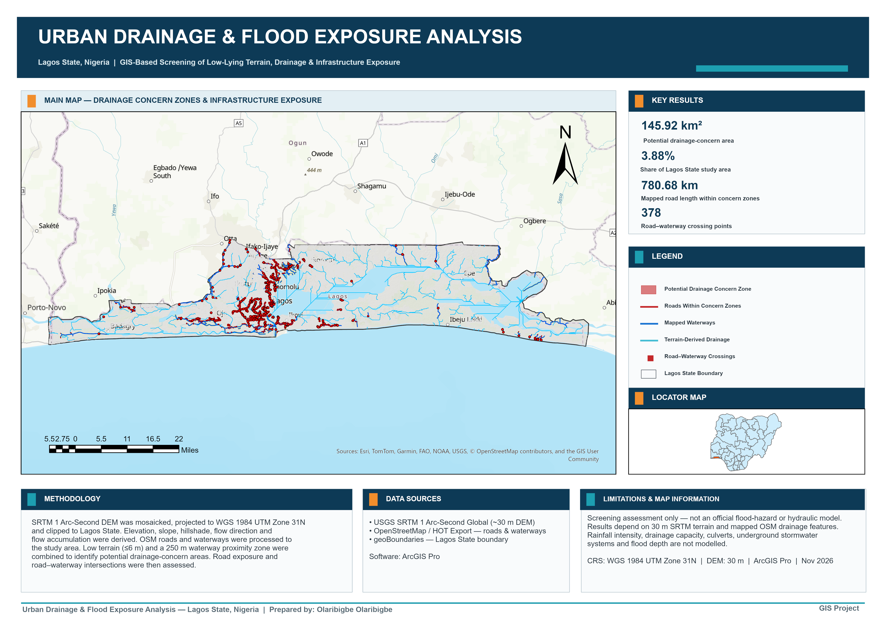

# Urban Drainage & Flood Exposure Analysis — Lagos State, Nigeria

## Project Overview

This project presents a GIS-based screening assessment of potential urban drainage concerns in Lagos State, Nigeria.

The analysis combines terrain elevation, mapped waterways, roads, terrain-derived drainage patterns and proximity analysis to identify locations where low-lying terrain and infrastructure exposure coincide.

The project was developed in ArcGIS Pro as a practical GIS portfolio exercise focused on terrain analysis, hydrological processing, infrastructure exposure and professional cartographic presentation.

> **Important:** This project is a screening assessment and should not be interpreted as an official flood-hazard or hydraulic model.

---

## Project Objective

The analysis was designed to answer four practical questions:

- Where are the lowest-lying parts of Lagos State?
- Which low-lying areas are close to mapped waterways?
- How much mapped road infrastructure intersects these potential drainage-concern zones?
- Where do mapped roads cross waterways?

---

## Study Area

**Lagos State, Nigeria**

Coordinate system used for analysis:

- **WGS 1984 UTM Zone 31N**
- EPSG: 32631
- Units: metres

Calculated study-area size from the GIS boundary:

**3,760.19 km²**

---

## Data Sources

### Elevation

**SRTM 1 Arc-Second Global**

- Source: USGS EarthExplorer
- Approximate spatial resolution: 30 m

Three SRTM tiles were mosaicked for the study area before projection and clipping.

### Roads and Waterways

OpenStreetMap data was obtained through the **Humanitarian OpenStreetMap Team Export Tool**.

The dataset was separated into:

- Roads
- Waterways

### Administrative Boundary

Lagos State administrative boundary data was obtained from **geoBoundaries**.

---

## GIS Workflow

### 1. Study Area Preparation

Nigeria administrative boundaries were used to extract Lagos State.

The study boundary was projected to:

**WGS 1984 UTM Zone 31N**

---

### 2. DEM Preparation

Three SRTM tiles were downloaded and mosaicked.

The mosaic was:

- converted using 16-bit signed elevation values
- projected to UTM Zone 31N
- resampled to approximately 30 m
- clipped to the Lagos State boundary

Final DEM:

`Lagos_DEM.tif`

---

### 3. Terrain Analysis

The DEM was used to derive:

- Hillshade
- Slope
- Filled DEM
- Flow Direction
- Flow Accumulation

These terrain products provided supporting information on surface drainage patterns.

---

### 4. Terrain-Derived Drainage Network

Flow accumulation was used to identify cells with relatively large contributing areas.

A screening threshold of:

**5,000 accumulated cells**

was used to create a terrain-derived drainage raster.

The raster was converted to polyline features using **Stream to Feature**.

This layer was treated only as a terrain-based drainage indicator and not as a representation of the complete engineered drainage system of Lagos.

---

### 5. Mapped Roads and Waterways

OpenStreetMap line data was separated into:

- `Lagos_Roads`
- `Lagos_Waterways`

The datasets were projected to UTM Zone 31N and clipped to the Lagos State boundary.

---

### 6. Waterway Proximity

A **250 m buffer** was created around mapped waterways.

The distance represents a GIS screening distance for this portfolio analysis and should not be interpreted as an official regulatory floodplain.

---

### 7. Low-Elevation Screening

The Lagos DEM was classified using Natural Breaks.

The lowest terrain class was approximately:

**≤ 6 m elevation**

This class was extracted as:

`Low_Elevation_6m.tif`

---

### 8. Potential Drainage-Concern Zones

Low-elevation terrain was combined with the 250 m waterway proximity zone.

Areas satisfying both conditions were mapped as:

**Potential Drainage Concern Zones**

These represent locations where low terrain and proximity to mapped waterways coincide.

---

### 9. Road Exposure Analysis

Mapped roads were clipped using the drainage-concern zones.

Road geometry was calculated in kilometres and summarized.

### Result

**Approximately 780.68 km of mapped roads intersect the screening zones.**

---

### 10. Road–Waterway Crossing Analysis

Roads and mapped waterways were intersected.

Multipart intersections were converted to single points.

### Result

**378 road–waterway crossing points were identified.**

These locations may represent bridges, culverts or other drainage crossings requiring more detailed investigation.

---

## Key Results

| Indicator | Result |
|---|---:|
| Lagos State study area | 3,760.19 km² |
| Potential drainage-concern area | 145.92 km² |
| Share of study area | 3.88% |
| Road length within concern zones | 780.68 km |
| Road–waterway crossing points | 378 |

---

## Interpretation

Approximately **145.92 km²**, representing **3.88%** of the Lagos State study area, was identified as low-lying terrain within 250 m of mapped waterways.

Approximately **780.68 km of mapped roads** intersect these screening zones.

A further **378 road–waterway crossing points** were identified.

These results indicate locations that may justify more detailed drainage, flood-risk or infrastructure investigation.

---

## Limitations

This project is not a hydraulic flood model.

The analysis does not model:

- rainfall intensity
- storm duration
- flood depth
- flood velocity
- culvert capacity
- drainage-channel capacity
- underground stormwater systems
- tide or storm-surge effects
- detailed building-scale terrain

The results depend on approximately 30 m SRTM elevation data and the completeness of mapped OpenStreetMap waterways and roads.

The identified areas should therefore be interpreted as **screening-level drainage-concern zones**, not confirmed flood zones.

---

## Main GIS Skills Demonstrated

- ArcGIS Pro
- DEM processing
- Raster mosaicking
- Raster projection
- Extract by Mask
- Hillshade
- Slope analysis
- Fill
- Flow Direction
- Flow Accumulation
- Raster Calculator
- Stream extraction
- Stream to Feature
- OpenStreetMap data preparation
- Buffer analysis
- Clip
- Intersect
- Multipart to Singlepart
- Geometry calculations
- Summary Statistics
- Raster–vector integration
- Infrastructure exposure analysis
- Cartographic layout design

---

## Project Files

### Final Map

`Urban_Drainage_Flood_Exposure_Lagos.png`

High-resolution portfolio map.

### PDF

`Urban_Drainage_Flood_Exposure_Lagos.pdf`

A3 landscape PDF version of the final analysis.

### ArcGIS Pro Layout

`Lagos_Urban_Drainage_Flood_Exposure_A3_Landscape.pagx`

Reusable A3 landscape ArcGIS Pro layout template.

### ArcGIS Pro Project

`Urban_Drainage_Flood_Exposure_Lagos.aprx`

Main ArcGIS Pro project.

Large source and intermediate raster datasets are not included in the repository because of file-size considerations.

---

## Software

**ArcGIS Pro**

---

## Project Status

**Completed — November 2026**

This project forms part of a GIS demonstrating practical terrain analysis, hydrological GIS, infrastructure exposure assessment and professional cartographic communication.

## Author

**Olaribigbe Olamiposi**

GIS / Geospatial Analysis 
